 

Consultas de negocio en **SQL Server** sobre **Northwind**, la base de datos de ejemplo de Microsoft con clientes, órdenes, productos y empleados de una distribuidora.

> La versión completa, con el tablero de Tableau, está en **[Análisis de ventas con SQL y Tableau](https://github.com/Monokhan/Analisis-de-ventas-con-SQL-y-Tableau)**.

## 🧩 Las 16 consultas

| # | Pregunta de negocio | Técnica |
|---|---|---|
| 1 | Top 10 de productos por unidades vendidas | `JOIN` · `GROUP BY` · `TOP` |
| 2 | Producto con el segundo precio más alto | Subconsulta correlacionada |
| 3 | Ranking de productos vendidos por ciudad en EE. UU. | `DENSE_RANK() OVER (PARTITION BY …)` |
| 4 | Órdenes de más de 10.000 que tardaron más de 2 días en despacharse | `DATEDIFF` · `HAVING` |
| 5 | Top 10 de clientes más valiosos de 2017 | `SUM(cantidad × precio)` |
| 6 | Productos con ventas ≥ $30.000 en 2018 y sus unidades | Agregación con filtro |
| 7 | Clasificación de clientes en niveles A, B y C según ventas | `CASE WHEN` |
| 8 | Clientes de 2018 con ventas sobre el promedio | Subconsulta en `HAVING` |
| 9 | Clientes que no compran hace más de 20 meses | `MAX` · `DATEDIFF` · `GETDATE()` |
| 10 | Número de órdenes por cliente | Subconsulta en `SELECT` |
| 11 | Días entre órdenes consecutivas | *Self join* |
| 12 | Top 3 de vendedores y su bono del 2 % | Agregación y cálculo |
| 13 | Empleados por cargo y ciudad | `GROUP BY` múltiple |
| 14 | Años de antigüedad de cada empleado | `DATEDIFF(YEAR, …)` |
| 15 | Empleados de 70 años o más | Filtro por edad calculada |
| 16 | Consulta (o vista) que reúne ventas, clientes, productos y categorías para exportar a Tableau | `JOIN` de 5 tablas · `CREATE VIEW` |

## 🚀 Cómo usarlo

1. Restaura la base **Northwind** en SQL Server.
2. Abre cualquier `SQL ejercicio N.sql` en SQL Server Management Studio y ejecútalo.

---

Hecho por **[Marcelo Reinoso](https://github.com/Monokhan)** · datos aplicados a minería e infraestructura

